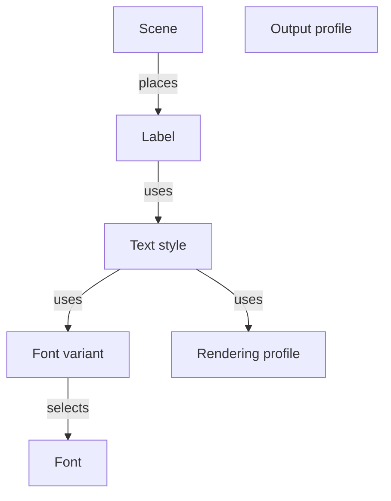

# Product domain model

## Terminology

| Term                  | Definition                                                           |
| --------------------- | -------------------------------------------------------------------- |
| **Font**              | TTF file.                                                            |
| **Font variant**      | Settings for a font: size and values for its variation axes.         |
| **Rendering profile** | Spacing, kerning, fitting, and hinting settings.                     |
| **Text style**        | Named combination of a font variant and a rendering profile.         |
| **Label**             | Text with a text style.                                              |
| **Scene**             | Labels, their positions, and scene dimensions.                       |
| **Output profile**    | Monochrome or grayscale settings: bit depth, levels, and tone curve. |
| **Bitmap font**       | Generated glyph bitmaps and layout metrics.                          |

## UI composition

Label positions belong to the scene.

A 400 × 300 px scene places the label “Settings” at (16, 12). The label uses “Header,” a text style combining a 24 px
Roboto font variant with the “Small screen” rendering profile.

## Font generation and export

A text style and an output profile determine how a bitmap font is generated.

Exporting fonts from the Scene page generates bitmap fonts for all text styles and packages them in a ZIP archive.
